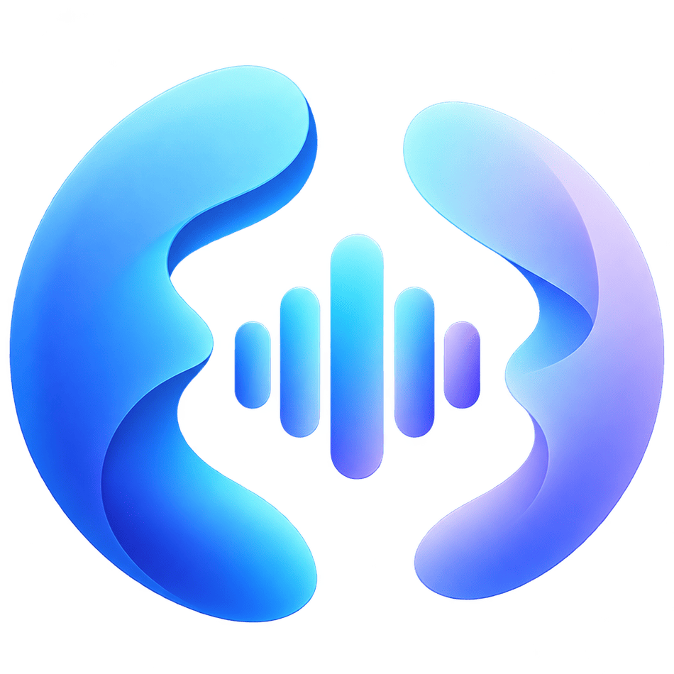

<div align="center">



# EchoDiar

**A local-first meeting recorder for macOS: your voice and the meeting's audio, on separate channels.**

</div>

> EchoDiar is in early development. There is no release yet; build it from source (see [CONTRIBUTING.md](CONTRIBUTING.md)).

## Features

- Record one app's audio (Google Meet in a browser, Teams, Zoom, ...) or all system audio, plus your microphone. The mic and the system audio go to separate channels of the same file.
- Pause and resume, live level meters, and a menu bar icon that shows idle, recording, paused and processing.
- A conversation library grouped by day: rename (double-click the title), Reveal in Finder, delete to the Trash, size on disk.
- After each recording, the audio is compressed to AAC (64 kbps by default). The original is deleted only after the compressed file is checked.
- Crash recovery: a recording interrupted by a crash shows up as "Recovered" and is kept.
- First-run onboarding: a consent reminder with a "Copy consent message" button, the microphone prompt, and a system audio test.

Roadmap: transcription, speaker separation, AI summary.

## Requirements

macOS 15 or later on Apple Silicon.

## Permissions

- **Microphone**: records your voice.
- **System Audio Recording**: records the meeting app's audio. macOS gives silence instead of an error when it is off; onboarding tests it and opens the right Privacy & Security pane.
- **Accessibility** (optional, later): not used yet. A later version will use it only to follow the meeting window.

Always tell the other participants that you are recording, and follow the law where you and they live.

## Privacy

EchoDiar is local-first. Recordings stay on your Mac, in `~/Library/Application Support/EchoDiar/`, and nothing is uploaded. There is no account, no analytics and no network call.

## Development

```sh
brew install xcodegen
scripts/dev.sh   # generate the project, build Debug, launch
xcodebuild test -project EchoDiar.xcodeproj -scheme EchoDiar
```

See [CONTRIBUTING.md](CONTRIBUTING.md).

## License

© 2026 Anh-Thi Dinh. EchoDiar is licensed under the GNU Affero General Public License v3.0, see [LICENSE](LICENSE).
