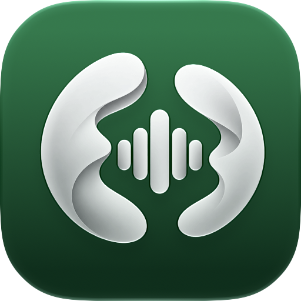
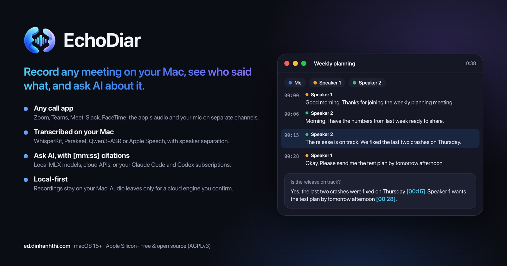

<div align="center">



# EchoDiar

**Record any meeting on your Mac, see who said what, and ask AI about it.**

[](https://github.com/dinhanhthi/EchoDiar/releases/latest)
[](LICENSE)


[Website](https://ed.dinhanhthi.com) · [Download](https://github.com/dinhanhthi/EchoDiar/releases/latest) · [Docs](https://ed.dinhanhthi.com/docs.html) · [Changelog](CHANGELOG.md)



</div>

## Features

- Record one meeting app (Google Meet in a browser, Teams, Zoom, ...) or all system audio, plus your microphone, on separate channels. Pause, resume, live level meters and a menu bar status.
- On-device transcription (WhisperKit, Parakeet, Qwen3-ASR or Apple Speech) with optional speaker separation and a transcript you can click to hear each line. WhisperKit and Parakeet transcribe while you record, with live captions, so the transcript is ready seconds after Stop.
- Optional cloud transcription: OpenAI-compatible services, ElevenLabs, Gemini, Deepgram and AssemblyAI.
- AI summaries and chat with on-device Foundation Models, local MLX models, local servers (LM Studio, Ollama, ...), cloud APIs (OpenAI, Anthropic, Gemini, ...) or coding CLIs (Claude Code, Codex, OpenCode, Gemini CLI). Answers cite timestamps that jump to that moment. "Copy as prompt" for any other AI tool.
- Meeting detection that offers to record, a floating indicator that can follow the meeting window, and auto-stop when the call ends.
- Calendar triggers with any account in macOS Calendar (iCloud, Google, Outlook/Exchange, ...): when a meeting starts, EchoDiar asks, waits for the call or records right away (without asking only for events you organize, accepted or answered Maybe to, and events without invitees in the EchoDiar calendar or a calendar On My Mac; other events ask), names the recording after the event and can stop when it ends. A Calendar page and the menu bar list upcoming meetings to join, record or skip, and you can create your own meetings, one-off or repeating.
- A library grouped by day with search (⌘F), compression to AAC, crash recovery, automatic deletion of old recordings, global shortcuts to record (⌥⌘R) and pause (⌥⌘P) and automatic updates.

## Install

### macOS

Download the `.dmg` from [Releases](https://github.com/dinhanhthi/EchoDiar/releases/latest), drag EchoDiar to `/Applications` and launch it. Requires macOS 15 or later on Apple Silicon.

### Windows 11 (x64, Arm64)

Download and run `EchoDiar-Setup.exe`, as described in [Install on Windows](https://ed.dinhanhthi.com/docs.html#install-windows). Setup installs EchoDiar and keeps it updated. Windows warns twice, because EchoDiar is not yet signed by a public certificate authority:

- "Windows protected your PC": click **More info**, then **Run anyway**.
- "Unknown publisher": click **Yes**. This happens only once, to trust the EchoDiar certificate.

Why, how to check the download and what Setup changes: [Windows warnings](https://ed.dinhanhthi.com/docs.html#windows-warnings).

## Permissions

- **Microphone**: records your voice.
- **System Audio Recording**: records the meeting's audio. Onboarding tests it and opens the right Privacy & Security pane.
- **Accessibility** (optional): only to attach the recording indicator to the meeting window.
- **Calendars** (optional): reads your meetings from macOS Calendar to offer recording when they start and to name the recording, and adds the events you create to an "EchoDiar" calendar. EchoDiar writes to no other calendar.

Always tell the other participants that you are recording, and follow the law where you and they live.

## Privacy

- Local-first: recordings, transcripts, summaries and chats stay in `~/Library/Application Support/EchoDiar/`. No account, no analytics.
- API keys are stored in the Keychain.
- Calendars are read on this Mac; EchoDiar writes only to its own "EchoDiar" calendar (On My Mac when available, otherwise your default calendar account, e.g. iCloud, which then syncs those events like any other) and stores only that calendar's id, the ids of calendars you don't watch and the ids of meetings you skip. Don't share the EchoDiar calendar: anyone who can add events to it could start a recording. A recording started from an event takes the event's title, which goes to an AI provider only like any other conversation title, when you use one.
- Audio or transcripts go to a cloud provider or a CLI only when you choose one; cloud transcription asks once for each destination before sending audio.
- Models are downloaded from Hugging Face only when you click Download. Update checks use the Sparkle feed at `ed.dinhanhthi.com`.

## Resource usage

Idle in the background: **27 MB**, 0% CPU (measured 2026-10-19 on a Release build of 0.1.0 with `scripts/measure.sh idle 30`). Recording and transcribing have not been measured yet.

## Development

```sh
brew install xcodegen
scripts/dev.sh   # generate the project, build Debug, launch
```

See [CONTRIBUTING.md](CONTRIBUTING.md). Releases are maintainer-only, see [docs/RELEASING.md](docs/RELEASING.md).

## License

© 2026 Anh-Thi Dinh. Licensed under the GNU Affero General Public License v3.0 (AGPL-3.0), see [LICENSE](LICENSE).
